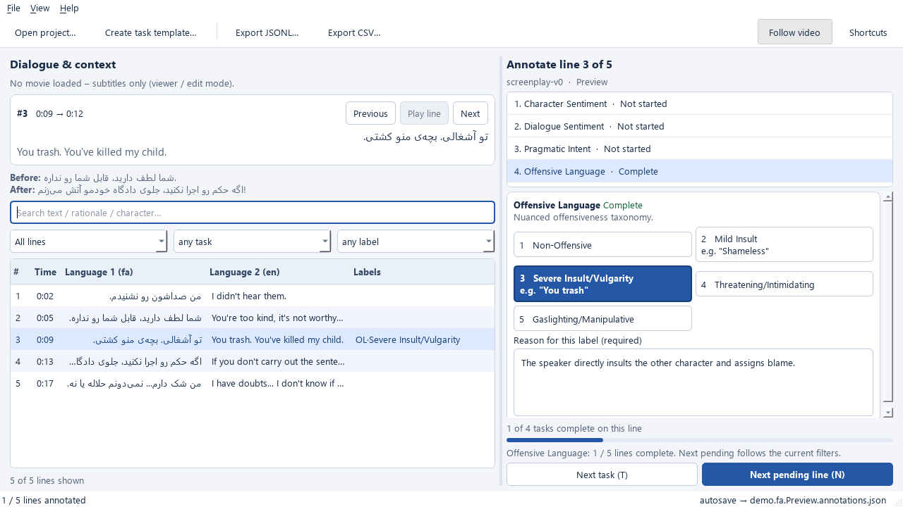

# Screenplay Annotation Tool

The updated PySide6 desktop workspace is in [`desktop/`](desktop/). It brings the
four screenplay tasks into one task selector, with a focused label editor,
bilingual dialogue, optional video, neighboring context, and a searchable line queue.



## Run the updated app

```powershell
python -m venv .venv
.\.venv\Scripts\python.exe -m pip install -r desktop/requirements.txt
.\.venv\Scripts\python.exe desktop/app.py
```

After setup, double-click **launch_annotator.cmd**. To try the bundled examples:

```powershell
.\.venv\Scripts\python.exe desktop/app.py --subs desktop/sample/demo.fa.srt --subs2 desktop/sample/demo.en.srt --annotator demo
```

The app uses an explicit light theme with readable fields and selection colors.
Select a task to choose a label and enter its reason. Task states show what is
complete or needs attention. **Next pending line** follows the selected task and
the current queue filters. Single-key shortcuts stay inactive while typing.

Use **Create task template…** to define reusable tasks, choices, instructions,
single or multiple labels, per-character entries, and optional or required reasons.
Select the saved template when opening a new subtitle project. Changes autosave,
and exports support JSONL, JSON, and CSV. Saved annotations reject mismatched task
templates to prevent edits under different label definitions.

See the [desktop guide](desktop/README.md) for details. This workspace supports
timed dialogue and subtitles. It does not implement image boxes, span annotation,
or adjudication. Earlier implementations and their launchers remain below and
use their own data formats; their working files are not automatically migrated.

## Test the updated app

```powershell
Push-Location desktop
..\.venv\Scripts\python.exe -I -m unittest discover -s tests
Pop-Location
```

The 12 tests cover storage and export, subtitle parsing, task selection, filtered
pending navigation, typing, reusable templates, and failed-save protection.

---

# Earlier standalone MVP

This repository now includes a small, fully offline PySide6 annotation app in the root files [`app.py`](app.py) and [`core.py`](core.py). It is independent of the older `app/` package described below. Python 3.9+ and PySide6 are required; PySide6 is the only third-party dependency for this MVP.

```powershell
python -m pip install PySide6
python app.py --subs sample/dialogue.fa.srt --subs2 sample/dialogue.en.srt --lang1 fa --lang2 en --annotator annotator-a
```

Run `python app.py` to use the native Open dialog. A movie is optional. The dialog accepts SRT, VTT, ASS and SSA subtitles; the first subtitle is required. It can also choose a schema JSON and output folder. `python app.py --dump-schema my-schema.json` writes an editable default schema. Each annotator's working JSON file is saved atomically in `annotations/` beside the first subtitle by default. The project can be reopened to edit labels and rationales. File → Export writes JSONL, JSON or UTF-8 BOM CSV. The include-unannotated toggle controls whether unlabeled lines appear in exports.

Keyboard: J/Down next, K/Up previous, N next unannotated, Space play/pause, P play current line, T next task, 1–9 pick a label, R focus rationale, Esc leave an editor. Shortcuts do not fire while typing. The right pane filters by text, status, task and label. Orange rows have incomplete annotations; they are saved and can be revised later.

```powershell
python -m unittest tests.test_screenplay_core tests.test_screenplay_gui -v
```

The GUI test uses Qt's offscreen platform. Video decoding depends on the Qt multimedia backend installed on the machine; annotation remains usable if playback fails.

---

# Screenplay Annotation Tool · پیکرهٔ دیالوگ فیلم‌ها

این پروژه یک برنامهٔ محلی برای آماده‌سازی و annotation فیلم‌هاست. چهار تسک در ارائهٔ `Screenplay.Annotation.1.pptx` منبع تعریف کلاس‌ها هستند؛ پیشنهادهای اجرایی داخل ارائه را دستور مستقل کار تلقی نکرده‌ایم. هنوز فایل فیلم یا زیرنویس مشخصی در این پوشه وجود ندارد و رکوردی از دیالوگ واقعی ساخته نشده است.

## اجرای برنامه

این برنامه اکنون یک **پنجرهٔ بومی Windows** است؛ مرورگر یا سرور HTTP برای کار با آن لازم نیست. روی `launch_desktop.cmd` یا `screenplay_annotation_tool.pyw` دوبار کلیک کنید. همچنین می‌توانید در PowerShell از ریشهٔ پروژه اجرا کنید:

```powershell
python -m app.desktop
```

برنامه بدون صفحهٔ ورود باز می‌شود. سه هویت محلی از قبل ساخته شده است: بازبین، حاشیه‌نویس الف و حاشیه‌نویس ب. تعویض هویت برچسب‌ها را جدا نگه می‌دارد و گذرواژه نمی‌خواهد. داده‌ها در پوشهٔ `data/`، خارج از Git، ذخیره می‌شوند. برای تغییر مسیر داده از `ANNOTATOR_DATA_DIR` استفاده کنید. نمایش فریم و پخش کلیپ به `ffmpeg` و `ffplay` در PATH نیاز دارد؛ ویدئو در یک پنجرهٔ بومی جدا پخش می‌شود. مسیر ویدئو به پروژه پیوند داده می‌شود و فایل بزرگ کپی نمی‌شود.

### گردش کار

1. از فهرست شش فیلم، فیلم و شناسهٔ نسخهٔ تصویر (release، مدت و frame rate) را انتخاب کنید. ویدئوی محلی را پیوند دهید. پخش MP4، MKV و WebM با `ffplay` انجام می‌شود.
2. SRT فارسی را وارد کنید؛ هر cue به یک **نامزد دیالوگ** تبدیل می‌شود. اگر SRT انگلیسی دارید، بعد از فارسی وارد کنید؛ بر اساس همپوشانی زمانی به‌صورت نامزد جفت می‌شود. با پخش ویدئو، زمان، متن، گوینده و مرز نوبت گفتار را اصلاح کنید؛ در صورت نیاز رکورد را تقسیم یا با بعدی ادغام کنید.
3. SRT مخصوص ناشنوایان را جدا وارد کنید. عبارت‌های نشان‌دارِ صدا/موسیقی به نامزد description تبدیل می‌شوند؛ این فقط استخراج اولیه است و پوشش صداها و گفتار باید با خود فیلم بررسی شود. وضعیت SDH را همراه با دلیل و شناسهٔ نسخه، `verified`، `rejected` یا `unavailable` ثبت کنید. برای کنش بصری مهم، description تازه در زمان پخش بسازید.
4. reviewer متن فارسی و ترجمهٔ انگلیسی هر دیالوگ را کنترل و وضعیت آن را `approved` می‌کند. دکمهٔ LLM فقط **پیش‌نویس** می‌سازد. برای فعال‌کردن آن، `OPENAI_API_KEY` و `ANNOTATOR_LLM_MODEL` را پیش از اجرای برنامه تنظیم کنید. هنگام استفاده، تنها متن فارسیِ هدف و چند نوبت نزدیک به [Responses API](https://developers.openai.com/api/docs/guides/text) ارسال می‌شود؛ تصویر و صدا ارسال نمی‌شود.
5. از نوار هویت، حاشیه‌نویس الف و سپس حاشیه‌نویس ب را انتخاب کنید. هر هویت فقط برچسب‌های خودش را می‌بیند. دیالوگ چهار تسک با کلاس‌های جدا دارد و هر برچسب rationale مستقل می‌خواهد: احساس شخصیت (روی دیالوگ اختیاری)، احساس دیالوگ، قصد کاربردی، و زبان توهین‌آمیز (شامل توهین خفیف/شدید، تهدید و دستکاری به‌صورت یک طبقه‌بندی). می‌توان یک تسک را ذخیره کرد و بعداً بقیه را کامل کرد. برای description، متن فارسی/انگلیسی، نوع و دلیل لازم است. جایی که بافت تصویری یا صدا گم می‌شود، بازبین با «توضیح در همین لحظه» رکورد description می‌سازد.
6. بعد از دو annotation مستقل، reviewer رکوردهای `Review ready` را بازبینی و اختلاف‌ها را داوری می‌کند. دکمهٔ Agreement توافق و Cohen’s κ را برای هر تسک نشان می‌دهد. خروجی `gold JSONL` فقط رکوردهای داوری‌شده را دارد؛ دیالوگ‌ها باید ترجمهٔ تأییدشده هم داشته باشند. `all JSONL` دادهٔ خام و داوری را برای بازبینی و بازیابی نگه می‌دارد. SRT فارسیِ اصلاح‌شده و SRT انگلیسیِ تأییدشده هم قابل خروجی گرفتن‌اند.

ویرایش متن/زمان یا ایجاد ترجمهٔ جدید، نسخهٔ رکورد را تغییر می‌دهد؛ برچسب‌های نسخهٔ قبلی دیگر در توافق و خروجی gold استفاده نمی‌شوند. بنابراین آماده‌سازی متن و ترجمه باید پیش از double annotation تمام شود. فایل‌های خام واردشده با هش SHA-256 در `data/tracks/` نگهداری می‌شوند. خروجی JSONL شامل متن، زمان، نوع رکورد، برچسب‌ها و rationale است و برای مرحلهٔ آموزش مدل قابل پردازش است.

### آزمون‌ها

```powershell
python -m unittest discover -s tests -v
python tests/desktop_smoke.py
```

آزمون پنجرهٔ بومی از پایگاه دادهٔ موقت استفاده می‌کند. فایل‌های رابط قدیمی مرورگر در مخزن باقی مانده‌اند، اما برای اجرای برنامهٔ دسکتاپ استفاده نمی‌شوند.

## نتیجهٔ جست‌وجوی زیرنویس (۱۴ اکتبر ۲۰۲۶)

«یافت شد» یعنی یک فهرست یا عرضه‌کننده وجود نسخه را نشان می‌دهد؛ همگامی با نسخهٔ فیلم، کیفیت متن و کامل بودن زیرنویس هنوز بررسی نشده است. عبارت «SDH نامشخص» یعنی وجود *زیرنویس فارسیِ گفتار همراه با صداهای مهم* تأیید نشده است. برچسب Hearing Impaired در یک سایت، بدون بازدید محتوای فایل و تطبیق زبان، برای این تأیید کافی نیست.

| فیلم | فارسی | انگلیسی | فارسی مخصوص ناشنوایان | شواهد |
|---|---|---|---|---|
| در دنیای تو ساعت چند است؟ | فهرست‌شده، از جمله ریلیز `-Per` | فهرست‌شده؛ نمایش جشنواره‌ای انگلیسی هم ثبت شده | **نامشخص**؛ ردیف Hearing Impaired دیده شده ولی فایل گفتار+صدا باز نشده | [OpenSubtitles](https://www.opensubtitles.org/ko/search/sublanguageid-all/idmovie-407653)، [MySubs](https://my-subs.co/film-versions-59253-whats-the-time-in-your-world-subtitles) |
| جدایی نادر از سیمین | چند فایل فارسی | چند فایل انگلیسی | **فهرست شده، فایل باز نشده**؛ Subf2m یک نسخهٔ فارسی مخصوص ناشنوایان را توضیح می‌دهد | [Subf2m](https://subf2m.co/subtitles/a-separation-jodaeiye-nader-az-simin)، [SubDL فارسی](https://subdl.com/subtitle/sd1067/a-separation-jodaeiye-nader-az-simin/farsi_persian) |
| شب‌های روشن (فرزاد مؤتمن، ۲۰۰۳) | یک فایل فارسی در Subf2m | دو فایل انگلیسی | **پیدا نشد**. نسخهٔ توضیح‌دار نابینایان SDH نیست. زیرنویس فارسی فیلم روسی ۱۹۶۰ را وارد نکنید | [Subf2m](https://subf2m.co/subtitles/shabhaye-roshan-white-nights) |
| پول و پارتی (سعید سهیلی، ۲۰۲۴) | فایل SRT مستقل پیدا نشد؛ پلتفرم پخش فقط نشان زیرنویس دارد | پیدا نشد | **نامشخص** | [شناسهٔ فیلم](https://www.imdb.com/title/tt33058750/) |
| متری شیش و نیم | یک فایل فارسی؛ علامت HI ندارد | چند فایل انگلیسی، به‌علاوه زیرنویس انگلیسی Apple TV | **نامشخص**؛ یک نسخه با عنوان مخصوص ناشنوایان در فیلیمو دیده می‌شود و با SRT معمولی یکی نیست | [SubDL](https://subdl.com/subtitle/sd1397722/just-65)، [Apple TV](https://tv.apple.com/us/movie/just-65/umc.cmc.3b6ge35ujjulhhx4zytp0507) |
| سن پطرزبورگ (بهروز افخمی، ۲۰۱۰) | فقط نام زبان در IMVBox، نه خود فایل | فقط نام زبان در IMVBox | **پیدا نشد** | [IMVBox](https://www.imvbox.com/en/movies/saint-petersburg-san-peterzburg) |

توجه: در صفحهٔ SubDL مربوط به «شب‌های روشن»، ردیف فارسی زیر بخش ترجمهٔ خودکار آمده است؛ وجود فایل فارسی را به استناد فهرست مستقل Subf2m ثبت کردیم. صفحهٔ IMVBox فهرست زبان را نشان می‌دهد، اما دسترسی به فایل SRT را اثبات نمی‌کند.

## تنظیمات پیشین Label Studio (اختیاری)

فایل‌های `label-studio/` و مبدل قدیمی SRT حفظ شده‌اند، اما برنامهٔ محلی بالا مسیر اصلی کار است. آن تنظیمات، ویرایش زمان روی فیلم، مدیریت کاربر، داوری و کنترل نسخهٔ رکورد را پوشش نمی‌دهند.

### ساخت پروژه

1. یک پروژهٔ دیالوگ در Label Studio بسازید و محتوای [`label-studio/dialogue.xml`](label-studio/dialogue.xml) را در Labeling Interface بگذارید.
2. پروژهٔ شرح صحنه را با [`label-studio/description.xml`](label-studio/description.xml) بسازید.
3. خروجی مبدل زیر را به پروژهٔ دیالوگ وارد کنید. هر ردیف یک زمان آغاز/پایان، متن فارسی و یک نامزد ترجمه دارد.

```powershell
python scripts/srt_to_label_studio.py --film-id separation-2011 --film-title "جدایی نادر از سیمین" --fa .\input\separation.fa.srt --en .\input\separation.en.srt --out .\output\separation.tasks.json --source-note "BluRay release identifier"
```

فایل انگلیسی اختیاری است. هم‌ترازی مبدل فقط بیشترین همپوشانی زمانی را انتخاب می‌کند؛ برابر بودن مرز cueها یا درستی ترجمه را تضمین نمی‌کند. برای ترجمهٔ LLM، فارسیِ بازشنوی‌شده و نهایی باید ورودی باشد؛ خروجی انگلیسی، اصطلاح‌ها، تعارف، کنایه، نام‌ها و حذف گفتار باید در بافت فیلم مرور و سپس `Approved` شود. فارسی و انگلیسی هر دو باید به همان نسخهٔ تصویر و صدا متصل باشند.

### واحد داده و مرور

- رکورد دیالوگ: `film_id`, `record_id`, `start_ms`, `end_ms`, `speaker`, `text_fa`, `text_en`, وضعیت ترجمه، منبع نسخه، چهار برچسب مستقل و rationale هر برچسب.
- رکورد description: `film_id`, `start_ms`, `end_ms`, نوع شرح، متن فارسی و انگلیسی، و دلیل نیاز به شرح. فقط اطلاعاتی را ثبت کنید که برای فهم کنش، مکان، گوینده یا صدای مؤثر لازم است. این رکورد را به‌جای دیالوگ قرار ندهید.
- خروجی هر annotator باید جدا بماند. بازبین اختلاف‌ها و نمونه‌ای تصادفی از موارد توافق را بررسی کند. هدف توافق `>0.75` و مرور ۲۰٪ در اسلایدهای ۲ و ۳ *پیشنهاد فرایندی ارائه* است و باید در طرح نهایی پروژه تصویب و تعریف دقیق شود.
- برچسب شخصیت در طول روایت، وابسته به شخصیت و بافت پیشین است. cueهای فاقد گوینده یا cueهایی که فقط صدای محیط هستند پیش از چهار تسک دیالوگ باید جدا یا اصلاح شوند.

## گام لازم برای شروع دادهٔ واقعی

برای هر فیلم، نسخهٔ دقیق و قابل استفادهٔ تصویر/صدا یا شناسهٔ release، و اگر موجود است SRT فارسی/انگلیسی و SDH را در اختیار بگذارید. سپس می‌توان همگامی، متن فارسی، ترجمهٔ LLM، توضیحات صحنه و کیفیت زیرنویس مخصوص ناشنوایان را روی *همان نسخه* کنترل کرد. بدون خود فیلم، قضاوت دربارهٔ گفتار، صدای صحنه و بافت بصری قابل اتکا نیست.
